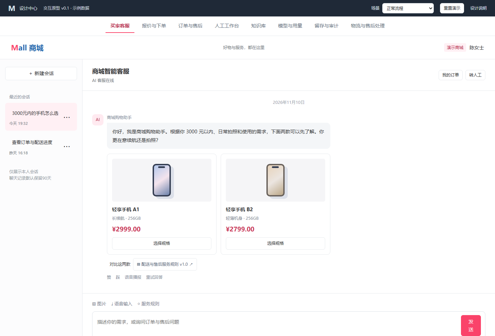
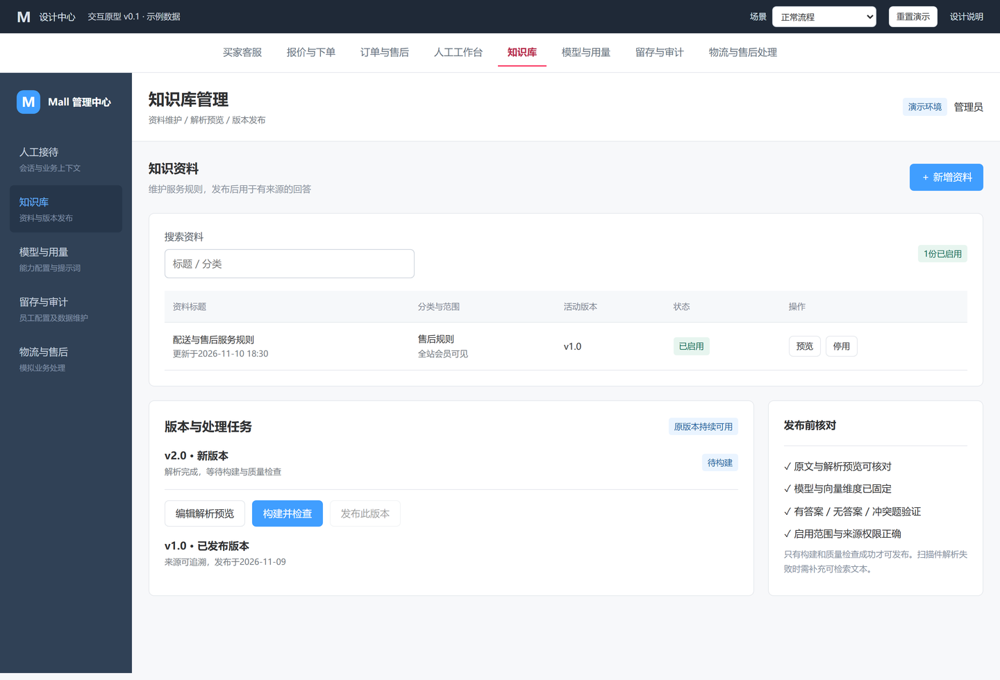

# 商城客服智能体


在开源商城 [mall-swarm](https://github.com/macrozheng/mall-swarm) 之上实现的电商客服智能体。买家从商品详情进入对话，可以查商品、查订单、看知识来源、转人工，也可以让模型**准备**加购、下单、取消和退货。

设计上有一条硬边界：**模型不能替买家确认，也不能自行执行交易**。模型只产出文本和工具计划；买家在确认卡上点确认后，由 Java 重新校验价格、库存、归属和业务条件，再提交事务。支付、退款和物流均为模拟流程。

## 功能

| 模块 | 能力 |
| --- | --- |
| 买家 H5 | 登录注册、首页 / 分类 / 品牌、商品详情、Elasticsearch 中文搜索、购物车、下单、订单与模拟物流、售后、收藏与足迹 |
| 客服对话 | 文字流式回复（SSE，断线可恢复）、图片咨询、语音、停止与重试、知识来源引用、转人工队列 |
| 交易确认 | 加购、下单、取消、退货四类确认卡；确认后由 Java 校验并落库，桥接带请求签名、防重放与幂等键 |
| 管理端 | 商城后台（商品、订单、营销、权限）；智能体工作台、人工接待、知识库与版本、退货规则、模型与用量、治理 |
| 工程保障 | 643 项 Python 测试、Maven 编译、前端测试与类型检查、密钥扫描、Compose 一键演示栈、52 篇设计与验收文档 |

## 界面

| 买家端 · 智能客服 | 管理端 · 知识库 |
| --- | --- |
|  |  |

上图为可交互原型 `docs/ui/index.html` 的截图，使用示例数据。克隆后用浏览器直接打开该文件即可点击体验，原型不连接真实服务。

## 技术栈

| 层 | 技术 |
| --- | --- |
| Java 服务 | Java 17、Spring Boot 3.5、Spring Cloud 2025、MyBatis、Nacos |
| 智能体 | Python 3.13、FastAPI、LangGraph、SQLAlchemy 2、Alembic、pytest |
| 前端 | Vue 3 + Vite + TypeScript + Pinia（管理端）、uni-app（买家 H5） |
| 数据 | MySQL 8、PostgreSQL 16、Redis 7、MongoDB 7、Elasticsearch 8（IK 分词）、Milvus 3、MinIO |
| 消息与部署 | RabbitMQ 3.13、Docker Compose |

## 运行演示

默认使用 `fixture` 模式。它不需要模型密钥，可以验证双端登录、商品查询、中文搜索、流式测试回复和进入人工队列。普通商城订单可在演示库中操作；`fixture` 不调用真实模型，也不替买家执行智能体交易。知识检索、视觉和语音需要相应的供应商配置。

需要 Linux 容器模式的 Docker、Compose v2 和 x86-64 环境；资源、Windows 命令和故障排查见[独立演示指南](deployment/demo/README.md)。克隆本仓库后，从仓库根目录运行：

```sh
cd deployment/demo
(umask 077; docker run --rm -i python:3.13.5-slim-bookworm python - < generate-env.py > demo.env)
docker compose --env-file demo.env up --build -d --wait --wait-timeout 480
python3 smoke.py
```

- **买家 H5**：`http://127.0.0.1:18180/`
- **管理后台**：`http://127.0.0.1:18181/`
- 演示账号和可操作场景见[独立演示指南](deployment/demo/README.md#克隆和启动)。默认端口仅供本机访问，使用的都是合成业务数据。生成的 `demo.env` 不提交。

如果要把中间件部署到独立 Linux 服务器，同时在本机调试前后端和 Python，见[本机联调指南](docs/本机运行.md)。离线镜像、业务快照和远程环境配置不随 Git 分发。

## 工程设计

```text
买家 H5 / 管理后台 → Java 网关
                     ├─ 商城 Java 服务 → MySQL（商品、库存、订单与售后）
                     └─ FastAPI 智能体 → PostgreSQL（会话、消息与知识版本）
                                  ├─ 受限工具 → 签名 Java 桥接
                                  ├─ LangGraph 与后台 worker
                                  └─ Milvus（可选，派生知识索引）
```

| 问题 | 实现 |
| --- | --- |
| 模型输出不等于业务事实 | 价格、库存和本人订单查 Java；知识回答返回来源，不能用模型生成的内容替代业务校验。 |
| 如何约束交易写入 | 模型工具可以查询、准备操作或请求转人工。确认接口独立，Java 重新校验价格、库存、归属和条件后执行。 |
| 重复提交和并发 | 桥接有请求签名和防重放；写操作使用幂等键，超时后按原操作号核对。购物车按会员加事务锁。 |
| 对话和接待恢复 | 会话和事件持久化；可恢复 SSE；人工接管时使用状态和版本约束避免覆盖新结果。 |

代码入口：[工具权限](mall-agent/app/api/runtime_tools.py) · [确认接口](mall-agent/app/api/actions.py) · [Java 桥接](mall-swarm/mall-portal/src/main/java/com/macro/mall/portal/controller/AgentCartBridgeController.java) · [系统架构](docs/07-系统架构与模块设计.md)

## 演示边界

| 项 | 现状 |
| --- | --- |
| 支付、退款、物流 | 模拟流程，不接真实资金与承运链路；接口返回值带 `is_simulated` 标记 |
| `fixture` 模式 | 不调用真实模型，返回预置回复，用于验证链路是否闭合 |
| 知识检索、视觉、语音 | 需自行配置供应商密钥；向量索引需按知识库文档自行构建 |
| 容量与性能 | 只验证功能闭环，未做生产级压测，也未做多可用区部署演练 |

## 项目结构

```text
mall-swarm/       Java 微服务：网关、认证、商品、订单、搜索、后台
mall-agent/       FastAPI 智能体：API、LangGraph、worker、数据库迁移、测试
mall-admin-web/   管理端（Vue 3 + Element Plus）
mall-app-web/     买家端（uni-app H5）
deployment/       Compose 编排、种子数据、验收与运维脚本
docs/             需求基线、架构分册、OpenAPI 契约、设计门户、历史验收
```

阅读顺序：[独立演示](deployment/demo/README.md) → [架构与模块](docs/07-系统架构与模块设计.md) → [发布验证](docs/发布验证.md)。如需浏览可点击原型，克隆后用浏览器打开 `docs/index.html`；它是一个离线可用的设计中心，含 24 节设计说明、可搜索的接口浏览器和可点击原型，不连接真实商城。

## 上游与许可

原商城来自 [mall-swarm](https://github.com/macrozheng/mall-swarm)、[mall-admin-web](https://github.com/macrozheng/mall-admin-web) 和 [mall-app-web](https://github.com/macrozheng/mall-app-web)，版本见[来源清单](deployment/source-lock.json)。本项目新增智能体、业务桥接、交易保护、两端客服页面和配套数据库扩展。上游样例业务记录不用于发布种子。

Apache-2.0。见 [LICENSE](LICENSE) 和 [NOTICE](NOTICE)。
